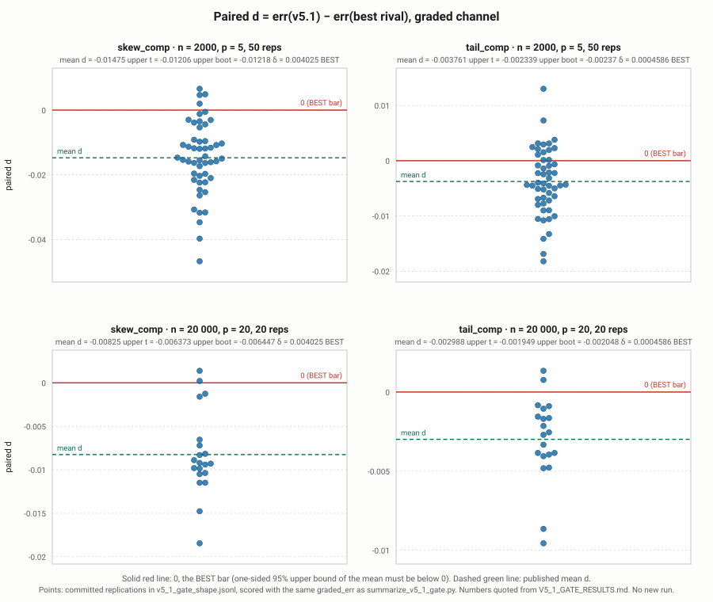

# TRACE v5.1: splitting a shift in distribution shape into composition and response on a mixture counterfactual

**Working paper.** Status: **SHIPPED (V5.1 only)**, opened 2026-11-09 (America/New_York)
as a skeleton; abstract, §3, §4 and the §5 figure were filled in on 2026-11-12.
Approved by the owner on 2026-11-05: *"Yes, ship V5.1: open the working-paper skeleton and app on
the passed V5.1 gate, sealed holdout untouched."* Decision record:
[DECISION_2026-11-04.md](../research/DECISION_2026-11-04.md) (PR #37).

**Ground rules for this document.** Docs only. Every number below is quoted from an existing
file in this repository, with a link to it; no new run was made for this paper. Indices
9600–9619 stay sealed and no holdout was run (PREREG_V5_1 §3, §6). §1, §2 and the §5 discussion
were filled in on 2026-11-10 from existing results and code only. The abstract, §3, §4 and the
§5 figure were filled in on 2026-11-12, still from existing results and code only: the figure
is drawn from the committed `benchmarks/results/v5_1_gate_shape.jsonl` by a deterministic
script ([fig_v5_1_paired_d.py](fig_v5_1_paired_d.py)) that runs no TRACE fit and touches no
seed.

Readable version: [docs/learn/v5_1_paper.html](../learn/v5_1_paper.html) ·
How to use it: [docs/learn/v5_1_app.html](../learn/v5_1_app.html).

---

## Abstract

When the distribution of an outcome changes between two periods A and B, part of the change
comes from the inputs moving (*composition*) and part from the way the outcome responds to the
inputs (*response*, also called *structure*). TRACE v5.1 splits the change in each L-moment of
the outcome into these two pieces. It builds the four mixture counterfactual laws
\(F_{[s,t]}(y)=E_{x\sim F_s}F_t(y\mid x)\) for \(s,t\in\{A,B\}\), with each period's
conditional law given by an ordinary-least-squares location fit plus that period's empirical
residual law, and takes the two-player Shapley split of the L-moment change. The fit is closed
form and has no tunable parameters
([PREREG_V5_1 §2](../research/PREREG_V5_1.md)). In a frozen, pre-registered gate on fresh
seeds, v5.1 was **BEST** against the better of two paired rivals (DFL reweighting and CFM) in
all four pure-composition cells, and passed the role check in all four
([V5_1_GATE_RESULTS.md](../benchmark/V5_1_GATE_RESULTS.md)). The simulator's mean is linear,
so this result says nothing about non-linear means; a follow-up that tried curved means was
pre-registered, run once, and parked ([PARK_V5_2.md](../research/PARK_V5_2.md)).

## 1. Problem

Decomposing a distribution shift's shape change (L-moments) into composition vs structure via a
four-hybrid mixture and a two-player Shapley split
([DECISION_2026-11-04.md, plan outline](../research/DECISION_2026-11-04.md)).

**Motivation.** Two samples are observed, period A and period B, each with inputs
\(x\in\mathbb R^p\) and a scalar outcome \(y\). The outcome's distribution differs between the
periods, and the question is *why*: because the inputs are distributed differently
(composition), or because the outcome responds to the same inputs differently (response, also
called structure). For the mean this is the classical two-way split. Here the target is the
whole *shape* of the outcome law: its location, scale, skewness and tail weight, each split into
a composition piece and a response piece that add up exactly to the observed change.

**Notation.** \(F_t(x)\) is the input law and \(F_t(y\mid x)\) the conditional outcome law in
period \(t\in\{A,B\}\). The mixture counterfactual with inputs from \(s\) and conditional law
from \(t\) is
\[
F_{[s,t]}(y)=E_{x\sim F_s}\,F_t(y\mid x),\qquad Q_{[s,t]}=F_{[s,t]}^{-1}\ \text{(left inverse)}.
\]
\(F_{[A,A]}\) and \(F_{[B,B]}\) are the two observed outcome laws; \(F_{[B,A]}\) and
\(F_{[A,B]}\) are the two counterfactuals ("B's inputs, A's response" and the reverse).
\(\lambda_r(F)\) is the \(r\)-th L-moment of a law, \(\lambda_r(F)=\int_0^1 Q(u)\,P^*_{r-1}(u)\,du\)
with \(P^*_{r-1}\) the shifted Legendre polynomial (`crates/core/src/trace/v5/mixture.rs`,
`lmoments_from_cdf_grid`). We write \(\lambda_{[s,t]}=\lambda(F_{[s,t]})\) for the vector of the
first \(K=4\) L-moments.

**Relation to existing methods.** \(F_{[s,t]}\) is the counterfactual distribution of
Chernozhukov, Fernández-Val and Melly (2013, *Inference on Counterfactual Distributions*,
Econometrica; cited in `crates/core/src/trace/v5/mod.rs` and
[REFS.md](../research/REFS.md)). Their estimator (CFM, one of the two gate rivals) builds the
conditional law from distribution regression; v5.1 builds it from a location model plus an
empirical residual law (§2). The counterfactual \(F_{[B,A]}\) is also what DiNardo, Fortin and
Lemieux (1996) reweighting estimates: reweight the A sample by \(w(x)=dF_B(x)/dF_A(x)\). The
repository checks this equivalence on a discrete-input example, in Rust
(`mixture_matches_dfl_reweighting` in `crates/core/src/trace/v5/explain.rs`) and in Python
(`test_mixture_matches_dfl_reweighting` in `tests/python/test_v5.py`), and through the full
`explain_v5` path with the booster location model
(`explain_comp_matches_dfl_on_location_model`). DFL reweighting is the second
gate rival. Both rivals are used only to produce L-moment splits on the same data and seeds
(`benchmarks/shiftbench/sb_shape_readout.py`); nothing from them is inside v5.1.

**Why L-moments.** L-moments (Hosking 1990, [REFS.md](../research/REFS.md)) are linear in the
quantile function, so they are defined for any law with a finite mean, are less sensitive to
the extreme tail than ordinary moments, and can be computed exactly for the piecewise-linear
gridded laws used here. Linearity in \(Q\) also means that for a pure location family the shape
channels (\(\lambda_2\) and up) do not move with the location, which is what lets the mixing
check in `mixing_residual_nonzero_while_barycenter_flat` separate a mixture effect from a shift.
\(\lambda_1\) is the mean, \(\lambda_2\) a scale, and \(\lambda_3\), \(\lambda_4\) carry skewness
and tail weight; the gate grades \(\lambda_3\) on `skew_comp` and \(\lambda_4\) on `tail_comp`
(§4–5).

## 2. Method (TRACE_V5_1)

Quoted from [PREREG_V5_1 §2](../research/PREREG_V5_1.md) (the frozen method):

* Per period \(t\in\{A,B\}\): \(\hat\mu_t(x)=\hat\beta_{0,t}+x^\top\hat\beta_t\), the
  least-squares fit of \(y\) on an intercept and all \(p\) columns of \(x\) (no penalty, no
  feature selection, no transforms). Residuals \(r_t=y-\hat\mu_t(x)\); residual law = empirical
  law of \(r_t\).
* Unchanged from v5 @ `3d695bc`: four hybrids \([A,A],[A,B],[B,A],[B,B]\) via
  `mixture_cdf_location`, 256-point support grid, `n_quad = 64`, exact L-moments of the gridded
  law, two-player Shapley split.
* Implemented in the Rust core with a thin Python switch (no neural nets). The fit is closed
  form; there are **no tunable parameters**.

Implementation: `TRACE_V5_1` = `explain_v5(..., mean_model="ols")` (PR #29), implementation
merge SHA `665939bd4aa78ffc7474b91d482d18ac0191d595`
([V5_1_GATE_RESULTS.md](../benchmark/V5_1_GATE_RESULTS.md), note 1). Code:
`crates/core/src/trace/v5/explain.rs` (`explain_v5`, `fit_ols`, `LocationModel::Ols`),
Python wrapper `python/traceot/v5.py` (`explain_v5_1`).

**Shapley split in full.** Treat the change \(\lambda_{[B,B]}-\lambda_{[A,A]}\) (per L-moment)
as a two-player cooperative game with players *c* (switch inputs A→B) and *s* (switch the
conditional law A→B). The value of a coalition is the L-moment of the hybrid with the switched
parts taken from B:
\[
v(\varnothing)=\lambda_{[A,A]},\quad v(\{c\})=\lambda_{[B,A]},\quad
v(\{s\})=\lambda_{[A,B]},\quad v(\{c,s\})=\lambda_{[B,B]}.
\]
The Shapley value of a player averages its marginal contribution over the two orders in which
the players can join:
\[
\hat c=\tfrac12\big[(\lambda_{[B,A]}-\lambda_{[A,A]})+(\lambda_{[B,B]}-\lambda_{[A,B]})\big],\qquad
\hat s=\tfrac12\big[(\lambda_{[A,B]}-\lambda_{[A,A]})+(\lambda_{[B,B]}-\lambda_{[B,A]})\big].
\]
These are exactly the `lsplit_comp` and `lsplit_struct` formulas in
`crates/core/src/trace/v5/explain.rs`. Writing the interaction
\(I=\lambda_{[B,B]}-\lambda_{[B,A]}-\lambda_{[A,B]}+\lambda_{[A,A]}\),
\[
\hat c=(\lambda_{[B,A]}-\lambda_{[A,A]})+\tfrac I2,\qquad
\hat s=(\lambda_{[A,B]}-\lambda_{[A,A]})+\tfrac I2,
\]
so the split gives each one-at-a-time effect and shares the interaction equally; it does not
depend on which switch is applied first (order-free). Adding the two displays,
\[
\hat c+\hat s=\lambda_{[B,B]}-\lambda_{[A,A]}\qquad\text{(budget identity)},
\]
exactly, for every L-moment. The identity is algebraic, so it holds in floating point up to
rounding; it is tested in `tests/python/test_v5.py` (`test_explain_v5_budget_is_exact`) and in
the Rust tests `mixing_residual_nonzero_while_barycenter_flat` (tolerance \(10^{-12}\)) and
`v5_1_pure_composition_shift` (\(10^{-10}\)).

**The four hybrids under v5.1.** With \(\hat\mu_t\) the OLS fit of period \(t\) and
\(r_{t,j}=y_{t,j}-\hat\mu_t(x_{t,j})\) its residuals (\(j=1..n_t\)),
\[
\hat F_{[s,t]}(y)=\frac1{n_s n_t}\sum_{i=1}^{n_s}\sum_{j=1}^{n_t}\mathbf 1\{\hat\mu_t(x_{s,i})+r_{t,j}\le y\},
\]
i.e. B's (or A's) inputs pushed through period \(t\)'s fitted mean plus period \(t\)'s empirical
residual law (`mixture_cdf_location`, exact pair counting, no smoothing or subsampling). For
\([A,A]\) and \([B,B]\) this is the law of fitted value plus an independently re-drawn own
residual. Because the OLS fit includes an intercept, a common shift of all inputs changes no
fitted value, so centring the inputs (as the benchmark harness does) does not change the
output.

**Grid and quadrature.** One support grid is shared by the four hybrids: \(n_y=256\) evenly
spaced points on \([\ell,h]\), where \(\ell\) and \(h\) are the smallest and largest value of
fitted mean plus residual over the four hybrids, so the grid covers every hybrid's support
(`support_grid`). \(\hat F_{[s,t]}\) is evaluated exactly at each grid point and treated as
linear between grid points, with atoms at the two ends for any mass at or beyond them. The
L-moments of that law are computed exactly: on each linear piece \(Q\) is linear in \(u\), so
\(\int Q\,P^*_r\) has a polynomial integrand of degree \(r+1\le 4\) for \(K=4\), and the code
integrates each piece with a 4-point Gauss–Legendre rule, exact to degree 7
(`lmoments_from_cdf_grid`). The
\(n_{\text{quad}}=64\) Gauss–Legendre nodes on \((0,1)\) are used only for the reported quantile
curves \(Q_{[s,t]}\), the Lagrangian barycenter \(\bar Q_{[s,t]}(u)=\overline{\hat\mu}+Q_{r_t}(u)\),
and the mixing residual \(\lVert Q_{[s,t]}-\bar Q_{[s,t]}\rVert_{L^2(0,1)}\); they do not enter
\(\hat c\) or \(\hat s\).

## 3. Pre-registration history (failures kept)

| step | freeze | verdict | record |
|---|---|---|---|
| v4 | `d50732f` | Overall accuracy **FAIL**; coverage **INCOMPLETE** | [V4_RESULTS.md](../benchmark/V4_RESULTS.md) |
| v5 first gate (mixture, binned mean booster) | `bce021e` | **FAIL** (n = 20 000 cells INCOMPLETE); kill rule applies, v5 first gate closed | [V5_GATE1_RESULTS.md](../benchmark/V5_GATE1_RESULTS.md), [PREREG_V5.md](../research/PREREG_V5.md) |
| v5 failure diagnosis | — | **EXPLORATORY**, not a gate, no claim; spent dev seeds 9500–9549 only | [V5_DIAGNOSIS.md](../research/V5_DIAGNOSIS.md) |
| **v5.1** (OLS location fit) | `b33f507` | **PASS** — all four cells BEST, all role checks PASS | [V5_1_GATE_RESULTS.md](../benchmark/V5_1_GATE_RESULTS.md), [PREREG_V5_1.md](../research/PREREG_V5_1.md) |
| v5.2 (curved means, additive spline) | `df5aff8` | **FAIL** — curved-mean claim parked | [V5_2_GATE_RESULTS.md](../benchmark/V5_2_GATE_RESULTS.md), [PARK_V5_2.md](../research/PARK_V5_2.md) |

Notes, quoted:

* v5 park: the v5 first gate closed under its kill rule ("its kill rule stands and the v5 first
  gate is closed", [PREREG_V5_1.md](../research/PREREG_V5_1.md), header). There is no separate
  `PARK_V5.md`; the record is V5_GATE1_RESULTS.md.
* v5.2 park: "V5.1's linear-mean claim stands exactly as stated in V5_1_GATE_RESULTS.md. This
  failure neither strengthens nor weakens it." ([PARK_V5_2.md](../research/PARK_V5_2.md))
* Holdout: "9600–9619 belong to the closed PREREG_V5 gate; they stay sealed and are not reused"
  (PREREG_V5_1 §3); "There is no separate holdout in this freeze; the gate seeds above are the
  test." (PREREG_V5_1 §6)

**Earlier scored suites (the v1–v3 accuracy line), all kept.**

* TRACE claims, PR #12 — first scored suite: [TRACE_CLAIMS_RESULTS.md](../benchmark/TRACE_CLAIMS_RESULTS.md),
  frozen by [PREREG_TRACE_CLAIMS.md](../benchmark/PREREG_TRACE_CLAIMS.md) as amended by
  [Amendment 1](../benchmark/PREREG_TRACE_CLAIMS_AMENDMENT_1.md).
* TRACE v3: [TRACE_V3_RESULTS.md](../benchmark/TRACE_V3_RESULTS.md), frozen by
  [PREREG_TRACE_V3.md](../benchmark/PREREG_TRACE_V3.md).

**What was learned at each step.** Every number in this subsection is quoted from the record
named in the sentence; no new run.

**TRACE claims (PR #12) and v3.** Both already showed the pattern that later drove v4 and v5.
TRACE recovered a structure-only skew change at n = 20 000 (H7 `skew_struct` recovery **PASS**
in both records) but not composition-driven shape changes: H7 recovery was 0.000 on every
`skew_comp`, `tail_comp` and `shape_mixed` cell in both records, and H7 overall was **FAIL**
(1 of 10 recovery cells). Against rivals, TRACE did not win on the composition cells (0 of 5
rival tests in both records; in PR #12, on `skew_comp` at n = 20 000, the paired difference vs
CFM was 0.071). Coverage of TRACE's bands also failed (H8(b) pooled 0.807 in PR #12 and 0.815
in v3, against a bar of 0.90). One identity that did pass, and stayed passing, is the
barycenter reconstruction (H5.1b in v3: 0 misses, worst 1.8e-15). v3's `pit_rounds=20` and
related changes did not move the composition-cell failure
([TRACE_CLAIMS_RESULTS.md](../benchmark/TRACE_CLAIMS_RESULTS.md);
[TRACE_V3_RESULTS.md](../benchmark/TRACE_V3_RESULTS.md)).

**v4** (`d50732f`). [V4_RESULTS.md](../benchmark/V4_RESULTS.md): overall accuracy **FAIL**
(all ten H7 cells FAIL); coverage **INCOMPLETE** (the cover track wrote 800 records with a
budget CI, but not the per-cell bands the bar requires); speed below the conditional 5× bar
(CFM/v4 = 1.02 at n = 10⁵ and 2.94 at n = 10⁶). The diagnosis in
[BOARD_V5.md](../research/BOARD_V5.md) §2–3, from the same frozen `v4_*.jsonl`, is that the
game was played on a Lagrangian quantile-curve average rather than on the mixture
counterfactual, and that estimated mass landed in the wrong role: on `skew_comp` at
n = 20 000, planted \(|\mathrm{truth}_c|\approx 0.040\) and
\(|\mathrm{truth}_s|\approx 0.0001\), but v4 averaged \(|\hat c|\approx 0.0027\) and
\(|\hat s|\approx 0.013\) (BOARD_V5 §2.1). That is what v5 was designed to change.

**v5 first gate** (`bce021e`). [V5_GATE1_RESULTS.md](../benchmark/V5_GATE1_RESULTS.md):
**FAIL**. At n = 2000, `skew_comp` had err 0.02699 with a 95% upper bound 0.00711, above
δ = 0.004025, and `tail_comp` had err 0.009708 with a role-check **FAIL** (mean
\(|\hat c|\) = 0.003115 below mean \(|\hat s|\) = 0.004922). The n = 20 000 cells are
**INCOMPLETE**: their indices 9600–9619 "are held back and must not be touched in this run"
(note 1). Under the kill rule an INCOMPLETE required cell blocks a PASS, and the first gate
is closed (PREREG_V5_1 header). The mixture object was in place; it was not enough with the
binned mean booster.

**v5 diagnosis** (exploratory, spent seeds 9500–9549 only; 9600–9619 not touched).
[V5_DIAGNOSIS.md](../research/V5_DIAGNOSIS.md), not a gate and not a claim. With the true
conditional, the same Eulerian mixture is **BEST** in both n = 2000 cells and the role check
passes; grid and inversion error is about \(10^{-6}\), "three orders below δ." Most of v5's
error is the location model (75% on `skew_comp`, 65% on `tail_comp`), a near-equal and opposite
transfer from composition to response. Ordinary least squares in place of the booster, on
those same spent seeds, removed the bias and both cells became BEST — "It is evidence for a
narrower pre-registered test on fresh seeds, not a result." The suspected heteroskedasticity
issue was not supported. The note already states that the simulator's mean is linear, so OLS
is the correct family by construction.

**v5.1** (`b33f507`). The test those diagnosis numbers pointed to, on fresh seeds 9700–9749
and 9800–9819. **PASS**: all four cells BEST, all four role checks PASS
([V5_1_GATE_RESULTS.md](../benchmark/V5_1_GATE_RESULTS.md); table, discussion and figure in
§5). Replacing only the location fit, and keeping the mixture, was enough on these
linear-mean pure-composition cells.

**v5.2** (`df5aff8`). The attempt to go past the linear-mean limit. **FAIL**, parked
([PARK_V5_2.md](../research/PARK_V5_2.md)): two cells INCOMPLETE (σ_B calibration infeasible),
accuracy FAIL after Holm on several tail and structure cells, a role FAIL, and false
attribution FAIL on all four structure-only cells. "V5.1's linear-mean claim stands exactly
as stated in V5_1_GATE_RESULTS.md. This failure neither strengthens nor weakens it."

## 4. Gate design

Cells, seeds and bars are as frozen in [PREREG_V5_1 §3–§5](../research/PREREG_V5_1.md),
which inherits generators, the truth file, `seed_of(...)` streams, the estimand and the
rivals from PREREG_V5 §3–4, and the bars from PREREG_V4 §5. What follows restates that
design in prose, citing the files it comes from. No new generator and no new bar.

**Simulator families.** The generators are the H7 shape scenarios of
[PREREG_TRACE_CLAIMS_AMENDMENT_1.md](../benchmark/PREREG_TRACE_CLAIMS_AMENDMENT_1.md) §A2,
implemented in `benchmarks/shiftbench/sb_dgp_shape.py` (PREREG_V5 §3: "Generators unchanged
from `benchmarks/` (H7 runner). **No new generators.**"). The mean is linear in both
periods,
\[
\mu(x)=1+x_{0:4}^{\top}\beta,\qquad \beta=(1.0,\,-0.8,\,0.6,\,0.4,\,-0.3),
\]
with independent \(N(0,1)\) features and \(N(0,1)\) noise in period A (Amendment 1 A2:
"Baseline as before… Every new law is centred (mean 0)"). At n = 20 000 the simulator uses
p = 20: the five active features and fifteen further independent \(N(0,1)\) columns that do
not enter \(\mu\) (`ShapeScenario.draw_x` and `mu` in `sb_dgp_shape.py`; PREREG_V5 §3,
"p as in the frozen H7 grid: 5 at 2e3, 20 at 2e4"). Period B changes only the *shape* of
one input law or of the noise; a scalar \(\sigma_B\), calibrated once on the oracle sample,
rescales period-B noise so that \(\lambda_2(Y_B)=\lambda_2(Y_A)\) (\(\lambda_1\) is already
matched because every law has mean 0). The two cells in this gate are:

* `skew_comp`: period-B feature \(x_0\) is drawn from a standardised \(\chi^2_3\) law
  (`chi3` = frozen `_skew_feature`); noise stays normal, scaled by \(\sigma_B\). Graded
  channel: \(\lambda_3\) (\(k=2\)). Planted as composition on that channel.
* `tail_comp`: period-B feature \(x_1\) is drawn from a scaled Student-\(t\) with 5 degrees
  of freedom (`t5` = \(t(5)\cdot\sqrt{3/5}\)); noise stays normal, scaled by \(\sigma_B\).
  Graded channel: \(\lambda_4\) (\(k=3\)). Planted as composition on that channel.

Three other families live in the same file and the same truth file — `skew_struct` (noise
→ `skew`), `tail_struct` (noise → `t5`), `shape_mixed` (\(x_0\) → `chi3` and noise →
`skewneg`) — and were **not** run under PREREG_V5_1 (out of scope, §6).

**Truth file.** [`benchmarks/results/shiftbench_truth_shape.json`](../../benchmarks/results/shiftbench_truth_shape.json),
built by `sb_dgp_shape.build_truth` on 2,000,000 oracle draws per law with raw RNG seed 99
(the same constant recorded in Amendment 1 A2 and in the spent-constant inventory of
[PREREG_V5_1_COVERAGE.md](../research/PREREG_V5_1_COVERAGE.md) §4; it is not a replication
index and is not in 9600–9619). For each family the file stores \(\sigma_B\), the L-moments
of the four hybrid laws \(Y_A\), \(Y_B\), \(Y_c=(X_B,\text{structure }A)\),
\(Y_{c'}=(X_A,\text{structure }B)\), and both the order-free Shapley split (the TRACE
estimand) and the A-reference split (the rival estimand). The graded-channel Shapley truths
used in the gate, already quoted in §5, are: `skew_comp` \(\lambda_3\) composition 0.04011,
structure −0.0001375; `tail_comp` \(\lambda_4\) composition 0.004298, structure 0.000288
(from [V5_1_GATE_RESULTS.md](../benchmark/V5_1_GATE_RESULTS.md), which reads them from this
file). \(\sigma_B\) and the achieved \(|\Delta\lambda_1|\), \(|\Delta\lambda_2|\) are in the
file; the amendment required \(|\Delta\lambda_2|\le 2\times 10^{-3}\) before any method ran.

**Estimand, rivals, seeds and bars.** The scored quantity is
\(\mathrm{err}=|\hat c_k-\mathrm{truth}_{c,k}|+|\hat s_k-\mathrm{truth}_{s,k}|\) on the
graded channel \(k\), each method against its own estimand (Amendment 1 A2; `graded_err` in
`summarize_v4.py`, used by `summarize_v5_1_gate.py`). Rivals DFL and CFM are re-run on the
same seeds, paired; \(d_r=\mathrm{err}_{\mathrm{v5.1},r}-\mathrm{err}_{\mathrm{best\,rival},r}\).
**BEST** if the one-sided 95% upper bound of mean \(d\) is below 0 (Student-\(t\) interval
with \(n-1\) degrees of freedom, and a 10,000-draw percentile bootstrap with seed 2026;
both must agree, the larger bound is used — V5_1_GATE_RESULTS note 2 records that this
scorer uses \(t\) rather than a normal quantile, which can only make a cell harder to pass).
**NON-INFERIOR** if that bound is below \(\delta=0.10\times\) the planted magnitude
(0.004025 on `skew_comp`, 0.0004586 on `tail_comp`, from the truth file). Role check: mean
\(|\hat c|>\) mean \(|\hat s|\) on the graded channel, and swapping the two roles does not
lower the error (operationalisation of V5_GATE1_RESULTS note 2). Gate **PASS** requires all
four cells BEST or NON-INFERIOR **and** all four role checks, with Holm across the four
paired tests. Wall cap 30 minutes on 8 cores; incomplete cells are never imputed. Seeds:
9700–9749 (n = 2000, p = 5, 50 reps) and 9800–9819 (n = 20 000, p = 20, 20 reps), disjoint
from the spent diagnosis seeds 9500–9549 and from the sealed 9600–9619 (PREREG_V5_1 §3).

## 5. Results

Quoted as is from [V5_1_GATE_RESULTS.md](../benchmark/V5_1_GATE_RESULTS.md)
(prereg `b33f507`, implementation merge `665939bd4aa78ffc7474b91d482d18ac0191d595`,
gate verdict **PASS**, wall time 15.0 s on 8 workers (cap 1800 s), 140/140 tasks finished):

| cell | n | p | reps | err v5.1 | err DFL | err CFM | mean d | upper t | upper boot | δ | verdict | \|ĉ\| | \|ŝ\| | role | p NI (Holm) | p BEST (Holm) |
|---|---:|---:|---:|---:|---:|---:|---:|---:|---:|---:|---|---:|---:|---|---|---|
| skew_comp | 2000 | 5 | 50 | 0.008351 | 0.07792 | 0.0231 | -0.01475 | -0.01206 | -0.01218 | 0.004025 | **BEST** | 0.0379 | 0.001774 | **PASS** | 4.21e-16 (1.68e-15) | 1.51e-12 (6.05e-12) |
| tail_comp | 2000 | 5 | 50 | 0.005568 | 0.01348 | 0.01138 | -0.003761 | -0.002339 | -0.00237 | 0.0004586 | **BEST** | 0.004493 | 0.001809 | **PASS** | 4.23e-06 (8.47e-06) | 2.62e-05 (5.23e-05) |
| skew_comp | 20000 | 20 | 20 | 0.002875 | 0.08113 | 0.01113 | -0.00825 | -0.006373 | -0.006447 | 0.004025 | **BEST** | 0.04097 | 0.0007853 | **PASS** | 3.5e-10 (1.05e-09) | 1.77e-07 (5.32e-07) |
| tail_comp | 20000 | 20 | 20 | 0.001933 | 0.009159 | 0.005063 | -0.002988 | -0.001949 | -0.002048 | 0.0004586 | **BEST** | 0.003909 | 0.0007253 | **PASS** | 7.98e-06 (8.47e-06) | 4.26e-05 (5.23e-05) |

Truth (Shapley, graded channel): skew_comp λ3: comp 0.04011, struct -0.0001375; tail_comp λ4: comp 0.004298, struct 0.000288.

p values are unadjusted with Holm (across the completed cells) in brackets.
Full numbers: [`benchmarks/results/v5_1_gate_summary.json`](../../benchmarks/results/v5_1_gate_summary.json);
per-replication records: [`benchmarks/results/v5_1_gate_shape.jsonl`](../../benchmarks/results/v5_1_gate_shape.jsonl).

**Discussion.** All numbers in this paragraph are read from the table above. In every cell the
v5.1 graded-channel error is below both rivals' (for example 0.008351 against DFL 0.07792 and
CFM 0.0231 on `skew_comp` at n = 2000), and the one-sided 95% upper bound of the paired
difference d is below zero by both the t-interval and the bootstrap, which is the BEST bar. Because each bound is below zero it is also below δ, so NON-INFERIOR holds as well. The CFM rival is the closer of the two in all four cells. From n = 2000 to
n = 20 000 (with p going from 5 to 20) the v5.1 error falls in both cells (0.008351 → 0.002875 on
`skew_comp`, 0.005568 → 0.001933 on `tail_comp`) while DFL's does not fall on `skew_comp`
(0.07792 → 0.08113); this is consistent with the v5.1 location fit being the correct family for
this simulator (§6) and is not evidence for anything outside it. The role check is clear in each
cell: mean \(|\hat c|\) is close to the planted composition truth (0.0379 and 0.04097 against
0.04011 on `skew_comp`; 0.004493 and 0.003909 against 0.004298 on `tail_comp`) and well above
mean \(|\hat s|\). The `tail_comp` cells sit closer to their bars than `skew_comp` in absolute
terms because the planted λ4 effect is roughly an order of magnitude smaller than the λ3 one (δ = 0.0004586 against
0.004025). Holm-adjusted p values stay below 0.05 in all four cells. Two things the table does
not show: whether a band around \(\hat c,\hat s\) would have the stated coverage (no band was
computed; the coverage study is pre-registered, held, not approved and not run — see
[PREREG_V5_1_COVERAGE.md](../research/PREREG_V5_1_COVERAGE.md) and
[HOLD_V5_1_COVERAGE.md](../research/HOLD_V5_1_COVERAGE.md)), and
anything about non-linear means (§6).

**Figure 1.** Paired \(d_r=\mathrm{err}_{\mathrm{v5.1},r}-\mathrm{err}_{\mathrm{best\,rival},r}\)
on the graded channel, one point per committed replication.

The figure is drawn from the already-committed
[`benchmarks/results/v5_1_gate_shape.jsonl`](../../benchmarks/results/v5_1_gate_shape.jsonl)
by the deterministic script [fig_v5_1_paired_d.py](fig_v5_1_paired_d.py), which uses the
same `graded_err` as `summarize_v5_1_gate.py`, runs no TRACE fit, and touches no seed
(indices 9600–9619 are not used). The solid line is 0, the BEST bar (the one-sided 95%
upper bound of the mean must be below 0). The dashed line, and the numbers printed above
each panel, are the published mean \(d\) and the published upper bounds and \(\delta\)
quoted from [V5_1_GATE_RESULTS.md](../benchmark/V5_1_GATE_RESULTS.md). The script checks
that the mean of the plotted points matches that published mean \(d\) to \(10^{-15}\).

## 6. Limitations

Quoted verbatim from [PREREG_V5_1 §7](../research/PREREG_V5_1.md) (Known limitation, stated in
advance):

> The simulator's mean is linear, so a linear location fit is the correct family by
> construction. A PASS shows that v5's mixture object works once the location model is
> right; it does **not** show robustness to non-linear means. That needs its own
> pre-registration.

Out of scope, quoted verbatim from [PREREG_V5_1 §6](../research/PREREG_V5_1.md):

> * Out of scope (not run under this SHA): `skew_struct`, `tail_struct`, `shape_mixed`,
>   coverage, ShiftBench, speed, per-feature shares, non-linear-mean scenarios.

The one attempt to go past the linear-mean limit (v5.2) failed and is parked
([PARK_V5_2.md](../research/PARK_V5_2.md)). The `mean_model="spline"` option stays in the
library and "carries no validated claim" (PARK_V5_2.md).

## 7. Software

Rust core `traceot_core::trace::{explain_v5, ExplainV5Config, LocationModel}` with
`LocationModel::Ols`; thin Python binding `traceot.explain_v5_1(x_a, y_a, x_b, y_b)`, the same as
`traceot.explain_v5(..., mean_model="ols")`. Since 2026-11-09 `"ols"` (v5.1) is the library
default, so `traceot.explain_v5(x_a, y_a, x_b, y_b)` runs v5.1; v5 stays selectable with
`mean_model="booster"`. Usage:
[v5_1_app.html](../learn/v5_1_app.html).

Since 2026-11-10 the report also carries a **report-only** residual-vs-fit check of each
period's location fit (`ExplainV5Report::linear_mean_check_a/_b`, Python
`result["linear_mean_check"]["a"/"b"]`): correlation of residuals with the fit and with the
squared centred fit, and mean residuals in ten equal-count bins of the fit. It is a diagnostic
only. It carries no validated claim, gates nothing, is computed after every other output is
final, and changes no other returned value. Small values do not show the mean is linear.

## 8. Open items

* [x] Write §1 (problem and related work), the full method in §2, and the discussion in §5
  (2026-11-10; existing results and code only).
* [x] Final abstract; §3 per-step paragraphs and v1–v3 records; §4 simulator and truth-file
  prose; §5 figure of paired d from the existing jsonl (2026-11-12; existing results and
  code only, no new run).
* [x] Linear-mean check in the application: residual-vs-fit check, report only, no gating claim
  (`linear_mean_check`, 2026-11-10; diagnostic only, §7).
* [ ] Release tag against the gate's implementation merge SHA
  `665939bd4aa78ffc7474b91d482d18ac0191d595` (decision plan item; not tagged yet).
* [ ] Non-linear means: need their own pre-registration on fresh seeds whose hypothesis is not
  chosen by looking at the v5.2 run (PARK_V5_2.md).
* [ ] Out-of-scope suites in PREREG_V5_1 §6 (struct cells, coverage, ShiftBench, speed,
  per-feature shares) each need their own pre-registration before any claim.
  Coverage: pre-registered in [PREREG_V5_1_COVERAGE.md](../research/PREREG_V5_1_COVERAGE.md),
  **held** on 2026-11-11 (the owner's words, verbatim: *"Not yet, hold the coverage study."*),
  not approved, not run. Record: [HOLD_V5_1_COVERAGE.md](../research/HOLD_V5_1_COVERAGE.md).
* [ ] Indices 9600–9619 stay sealed; no holdout confirmation of v5.1 is permitted by its prereg.
